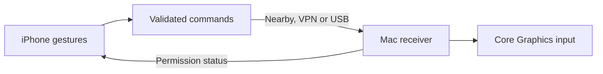

<p align="center">
  
</p>

<h1 align="center">RemotePad</h1>
<p align="center"><strong>Your iPhone. Your Mac’s trackpad.</strong></p>
<p align="center">A native iPhone trackpad and Mac companion with Wi-Fi, ZeroTier, NetBird, and USB connections.</p>
<p align="center">
  <a href="LICENSE">MIT licensed</a> · iOS 16+ · macOS 13+ · SwiftUI
</p>

[](https://github.com/aklyk/RemotePad/actions/workflows/build.yml)

RemotePad turns your iPhone’s screen into a trackpad for your Mac. Move the pointer, click, scroll, drag, zoom, and navigate desktop spaces. Choose Nearby for Wi-Fi discovery, ZeroTier or NetBird for access over your VPN, or USB for a direct cable connection.

> **Source release:** build the two apps using the instructions below. There is no App Store or notarized binary release yet. Moving the phone through the air does not move the pointer; slide your finger on its screen.

## Features

- **Multi-touch controls:** pointer movement, clicks, scrolling, long-press dragging, pinch zoom, and three-finger navigation.
- **Personal preferences:** adjustable pointer speed, natural or reversed scrolling, and optional gesture haptics, saved on your iPhone.
- **Visible connection health:** the iPhone warns when Mac Accessibility access is blocked; the Mac displays received-command counts.
- **Encrypted pairing:** nearby discovery with Apple’s Multipeer Connectivity, encryption required, and approval on the Mac for the first pairing.
- **Control on your terms:** one controller at a time, disconnect and pause controls, remembered-pairing revocation, and automatic mouse-button release after disconnect or six seconds without incoming packets.
- **Native apps:** SwiftUI interfaces, UIKit gesture recognition, Core Graphics input, and matching app icons.

## Get started

### Requirements

| | Minimum |
| --- | --- |
| iPhone | iOS 16 |
| Mac | macOS 13 |
| Building both apps | Xcode 15+ with the iOS SDK |
| Signing the iPhone app | An Apple Account configured in Xcode |
| Connection | Same Wi-Fi for Nearby, a shared ZeroTier/NetBird network for VPN, or a USB data cable and `iproxy` for USB |

A free Apple Account can be used for personal development. Apple may require Developer Mode and developer-profile trust on the iPhone. Development provisioning expires and may require rebuilding; follow the expiry shown by Xcode.

### 1. Build and run the Mac companion

```sh
git clone https://github.com/aklyk/RemotePad.git
cd RemotePad
./scripts/build-mac.sh
open "build/RemotePad Mac.app"
```

You can also open `RemotePad.xcodeproj` and run the **RemotePadMac** scheme.

In the companion, click **Enable Accessibility Access**, then enable **RemotePad Mac** in **System Settings → Privacy & Security → Accessibility**. Allow Local Network access and incoming connections if macOS asks. Keep the companion open in your logged-in desktop session.

The build script uses an available Apple Development signing identity, or ad hoc signing when none is available. It remembers that choice in the ignored `.remotepad-signing-identity` file so later builds do not silently switch identities. Override it explicitly with:

```sh
REMOTEPAD_SIGN_IDENTITY="Apple Development: Your Name (IDENTIFIER)" ./scripts/build-mac.sh
```

Ad hoc rebuilds and changes to an app’s signing identity can require granting Accessibility again. Use the same app location and signing identity between updates. This local development build is not notarized for distribution.

### 2. Install the iPhone app

1. Open `RemotePad.xcodeproj` in Xcode and select the **RemotePad** scheme.
2. Select the RemotePad target’s **Signing & Capabilities** tab. Choose your development team and replace `com.example.RemotePad` with your own unique bundle identifier.
3. Connect your iPhone to the Mac. Trust the computer and enable Developer Mode if requested.
4. Select the iPhone as the run destination, then click **Run**.
5. Allow **Local Network** access when RemotePad asks.

If iOS reports an untrusted developer, open **Settings → General → VPN & Device Management**, select your development profile, and complete the trust steps. See [Apple’s device-running guide](https://developer.apple.com/documentation/xcode/running-your-app-on-simulated-or-physical-devices).

### 3. Choose a connection and pair

#### Nearby

Open both apps, select your Mac on the iPhone, and click **Allow Connection** in the Mac companion. Both devices should be awake on the same Wi-Fi. Approve only a connection you just initiated: device display names are not verified identities.

Once connected, slide a finger across the large trackpad area. The iPhone keeps its screen awake while connected. Leaving the app disconnects it; open it again to reconnect automatically after the first pairing.

Turn the iPhone sideways or tap the expand button after connecting to use the entire screen as a trackpad. The hand icon opens the gesture guide in landscape.

#### ZeroTier or NetBird

1. Install the VPN client on both devices. In the iPhone’s **ZeroTier** tab, expand **Set up ZeroTier**, enter your 16-character **Network ID**, and tap **Join in ZeroTier One**. Authorize the iPhone and Mac in ZeroTier Central. In the **NetBird** tab, open NetBird and sign both devices into the same network. For a self-hosted NetBird network, set its management URL in the NetBird client. [ZeroTier setup](https://docs.zerotier.com/quickstart/) · [NetBird setup](https://docs.netbird.io/get-started/install)
2. In RemotePad on the Mac, turn on **Allow ZeroTier and NetBird connections**, then click **Copy Connection Key**. The Mac listens on TCP **49373** while this option and **Allow new connections** are enabled.
3. In RemotePad on the iPhone, enter your Mac’s VPN IP address or DNS name and the connection key. Tap **Connect**, then approve the connection on the Mac.

The official VPN client manages the tunnel. RemotePad connects to the address you enter using the iPhone’s routing table. Keep both VPN peers connected and allow TCP **49373** from the iPhone peer in your VPN access rules or Mac firewall, if applicable. The Mac listener accepts connections on its interfaces, guarded by the connection key and first-pairing approval. Keep this port off the public internet.

#### USB with Lightning or USB-C

1. On the Mac, install `libusbmuxd` with `brew install libusbmuxd`. The Mac app bundles a relay that uses the Homebrew library and disables TCP packet coalescing on the Mac-side socket. [libusbmuxd documentation](https://github.com/libimobiledevice/libusbmuxd)
2. Connect one iPhone with a data-capable cable. Unlock it and confirm **Trust This Computer** if prompted.
3. In RemotePad on Mac, click **Start USB**, then **Copy Connection Key**. In RemotePad on the iPhone, select **USB**, paste the key, and tap **Listen for Mac**. Approve the first connection on the Mac.

The helper uses USB-only forwarding, with Wi-Fi and VPN optional. Keep RemotePad in the foreground on the iPhone during use. If you unplug the cable, reconnect it while USB mode is enabled on the Mac. Actual latency depends on the devices, application scheduling, and display refresh.

## Automatic reconnection

Approve your iPhone once in the Mac companion. The apps save the pairing credentials in Keychain. **Automatically reconnect** is enabled by default. When you reopen RemotePad or return to it, it uses the selected connection mode and its saved pairing. For USB, **Start USB** must be active on the Mac. If your credentials were revoked, open **Settings → Connection → Forget this Mac** on the iPhone, then pair again.

**iOS background limit:** [Multipeer Connectivity disconnects sessions in the background](https://developer.apple.com/documentation/multipeerconnectivity). RemotePad cannot stay connected indefinitely while the iPhone app is closed or force-quit. It releases held input on leaving the foreground, remembers the pairing, and reconnects when you return. It does not use audio, location, or other unrelated background modes to bypass iOS restrictions.

On the Mac, closing the window keeps the companion running in the **menu bar**. Choose **Open RemotePad** there to reopen the window. Quitting the Mac app stops discovery and connections until it is launched again.

- **Forget this Mac** on iPhone removes its stored credential.
- **Forget All** on Mac revokes all saved pairings and resets the connection key for VPN and USB.
- **Disconnect** on iPhone stops automatic retries until you return to the app or connect manually.
- **Disconnect & Pause** on Mac pauses incoming connections until **Allow connections** is enabled again.

Returning phones must answer a fresh HMAC-SHA256 challenge before the Mac accepts any mouse commands. Secrets are delivered over the approved encrypted session, stored in Keychain, and never put in Bonjour advertisements or invitation contexts. The Mac disconnects a provisional session if authentication does not complete within five seconds.

VPN and USB use TLS with the Mac’s randomly generated connection key. Share this key only with devices you trust. The iPhone stores it after approval and keeps separate pairing profiles for Nearby, ZeroTier, NetBird, and USB.

## Gesture guide

| Gesture or control | Result |
| --- | --- |
| One-finger swipe | Move the pointer with speed-based acceleration |
| Tap / double-tap | Click / double-click |
| Two-finger tap | Right-click |
| Two-finger swipe | Scroll horizontally or vertically, with momentum on lift |
| Hold for 0.4 seconds, move, then lift | Drag and release |
| Drag button → swipe → Release | Keep a drag held across several swipes |
| Two-finger pinch | Zoom in compatible Mac apps when **Pinch to zoom** is enabled |
| Two-finger double-tap | Smart Zoom in compatible Mac apps when **Smart Zoom** is enabled |
| Two-finger twist | Rotate in compatible Mac apps |
| Two fingers from the right edge | Show Notification Center |
| Two-finger horizontal swipe with **Two-finger page swipes** on | Previous or next page in compatible Mac apps |
| Three-finger tap | Look up a word in the active app |
| Three-finger slide with **Three-finger drag** on | Drag and release on lift |
| Three- or four-finger swipe left / right | Next / previous desktop space |
| Three- or four-finger swipe up / down | Mission Control / application windows |
| Spread four fingers | Show the desktop |
| Pinch four fingers | Open Apps or Launchpad |
| Sliders icon or Gesture guide | Preferences and gesture reference |

**Settings.** **Pinch to zoom** and **Smart Zoom** are off by default. Enable them separately in **Settings → Preferences**. Pointer acceleration is on by default and can be toggled under **Pointer speed**. When **Three-finger drag** is on, use four fingers for navigation. **Two-finger page swipes** is off by default so a horizontal swipe scrolls.

**Compatibility.** Update both apps for all gestures. The Mac app uses the active app’s trackpad support for Smart Zoom, pinch, and rotation. Navigation respects your configured Mac shortcuts, including custom modifier keys. Space switching requires another desktop space. The iPhone provides optional vibration for gesture feedback. Force Touch pressure and Apple’s trackpad hardware haptics require a physical trackpad.

## Troubleshooting

| Symptom | What to check |
| --- | --- |
| No Mac appears | Keep the companion open, allow Local Network access on both devices, and tap Refresh on the phone. |
| VPN connection fails | Confirm both VPN clients are connected, use the Mac’s VPN address, and check the Mac toggle, connection key, and TCP 49373. |
| USB keeps waiting | Use a data cable, trust the Mac in Finder/iOS, disconnect other iPhones, and start USB in RemotePad on both devices. |
| Discovery fails on office or guest Wi-Fi | Guest isolation, firewalls, and VPNs can block peer discovery. Try a regular home Wi-Fi network. |
| Connected, but the pointer does not move | Check the phone’s permission warning and the Mac’s received-command counter. Enable Accessibility for the exact Mac app you launched. |
| Accessibility is on, but RemotePad says it is blocked | Remove RemotePad Mac from the Accessibility list, add the current `.app` again using **+**, enable it, then quit and reopen the companion. This can happen after signing changes. |
| Pairing expires | Select the Mac again and approve within 25 seconds. |
| Connection drops when switching iPhone apps | Expected: iOS disconnects peer sessions in the background. Return to RemotePad to reconnect automatically. |
| Zoom or space gestures do nothing | Focus a compatible Mac app and check its keyboard shortcuts. |
| App installs but iOS blocks opening it | Complete developer-profile trust and Developer Mode setup on the iPhone. |

The Mac companion only controls your current desktop session. Login screens and protected system interfaces are outside its scope.

## Development

```sh
# Validate command decoding, permission feedback, pairing authentication, and gesture calculations.
swift run ProtocolChecks

# Check click buttons and shortcut modifier cleanup without posting any input.
./scripts/check-mouse-driver.sh

# Build, package, sign, and verify the Mac companion.
./scripts/build-mac.sh

# Build iPhone source without a development signing identity.
xcodebuild -project RemotePad.xcodeproj -scheme RemotePad \
  -sdk iphonesimulator -destination 'generic/platform=iOS Simulator' \
  -derivedDataPath build/Simulator CODE_SIGNING_ALLOWED=NO build
```

GitHub Actions runs the protocol checks and builds both apps on macOS. Real-device discovery, multi-touch feel, permission transitions, and multi-monitor behavior still need hands-on testing; a passing build does not verify those interactions.

### Project structure

```text
Sources/
  iOS/        iPhone UI, gestures, peer discovery, connection status
  Mac/        Pairing UI, permission checks, command receiver, input events
  Shared/     Bounded command/status protocol and gesture calculations
Resources/    App icons, asset catalog, and permission declarations
Tests/        Standalone protocol and gesture checks
scripts/      Mac packaging and vector icon generation
```



Commands and status messages are bounded to 512 bytes. The receiver rejects malformed messages, unsupported actions, nonfinite coordinates, and excessive movement. Heartbeats maintain the drag safety timeout and refresh permission feedback. There is no telemetry or analytics service in this project.

To regenerate the vector-drawn icons:

```sh
swift scripts/generate-icons.swift
iconutil -c icns Resources/RemotePad.iconset -o Resources/RemotePad.icns
```

## Contributing

Bug reports and pull requests are welcome. Include the iOS/macOS versions, what each app shows for connection and Accessibility status, and steps to reproduce. Do not attach signing certificates, provisioning profiles, or account credentials. For a change, run the checks and both builds above, and describe any hardware testing you performed.

## License

[MIT](LICENSE) © 2026 Nacim Oualla.
